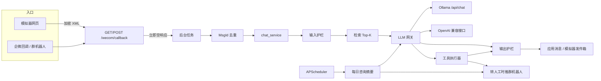

# 架构

M1 只有模型网关和 `/health`。下面这张图是后续里程碑要接上的整条链路。输出护栏同时接在模型正文和工具结果后面：没有工具调用时，模型原文也要过护栏。

## 后续里程碑约定

这些规则现在先定下来。对应代码在后面的里程碑里实现，除了示例密钥警告已经在启动时生效。

去重键优先用企微 `MsgId`。`MsgId` 为空时，用 `from_user`、`create_time` 和消息正文计算 SHA-256，作为兜底键。不要用空字符串当键，否则不同消息会被当成同一条。

`EMBED_MODEL` 默认 `bge-m3`，用环境变量覆盖。嵌入走 Ollama 的 `/api/embed`。

`.env.example` 里的 CorpID `wx5823bf96d3bd56c7`、Token `QDG6eK`、EncodingAESKey `jWmYm7qr5nMoAUwZRjGtBxmz3KA1tkAj3ykkR6q2B2C` 是企业微信文档的公开示例，只能用于本地模拟。进程启动时如果发现这些值，打 WARN。生产环境换成自己的应用配置。

日志、群机器人通知和错误信息里的手机号显示为前 3 位、4 个星号、后 4 位，例如 `138****1111`。查询预约和入库仍使用完整号码。
